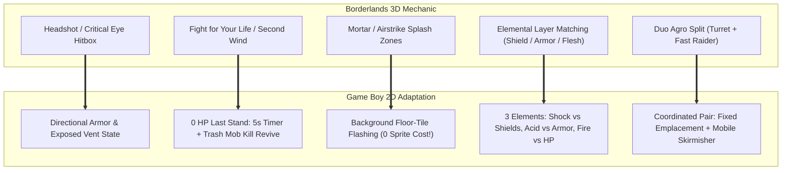
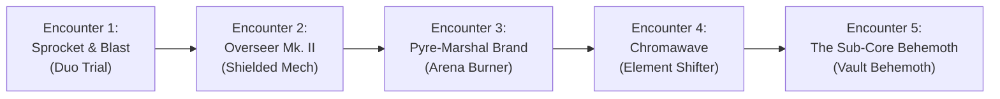
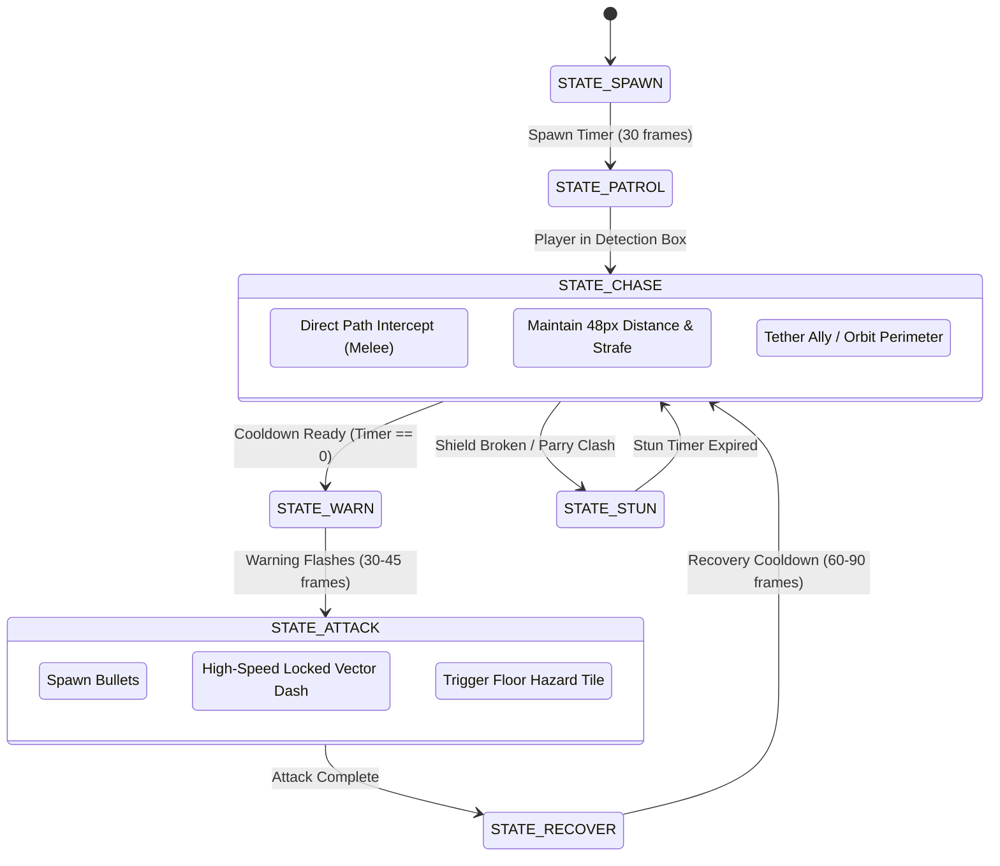

# Skavengar — Boss Encounters & Enemy Behavior Engine

> **Design Target**: Nintendo Game Boy (DMG) / Game Boy Color (CGB).  
> **Inspiration**: Downscaled 3D raid and campaign boss encounters from *Borderlands 2* adapted to a 160×144 2D top-down action roguelite.  
> **Hardware Budget**: SM83 CPU (4.19 / 8.38 MHz), 40 hardware sprites max, strict **10 sprites/scanline** limit, 8 active actor slots, 20 enemy bullets max.

---

## 1. 3D to 2D Downscaling Philosophy

In a 3D first-person shooter like *Borderlands*, boss fights challenge players through vertical line-of-sight, arena terrain elevation, tracking fast moving targets across 360°, and managing hordes of secondary minions ("adds") to trigger the iconic **Second Wind** revive.

On the 2D Game Boy screen ($160 \times 144$ pixels, 20×18 background tiles), we translate these 3D mechanics into tight, readable top-down systems:



### 1.1 The Golden Constraints of Game Boy Bosses
1. **The 10-Sprite Scanline Barrier**:
   - The Game Boy PPU can only draw **10 sprites (8px wide each) on any single horizontal line**.
   - If a boss is 24px wide (3 sprite columns), the player is 16px wide (2 sprite columns), and 3 enemy bullets pass through the same horizontal stripe, sprites **will drop and flicker**.
   - **Solution**: Bosses must have compact metasprite footprints (at most 16×16 or 16×24), and large room-wide attacks must be drawn via **Background Floor Tiles** (`BLK_FLOOR` hazard patterns queued to VRAM) rather than dozens of sprite projectiles.
2. **The Second Wind Safety Valve**:
   - In 2D shooters with high-damage bosses, sudden deaths feel punishing. By always keeping 1–2 low-HP trash mobs ("adds") active in the corners, players who drop to 0 HP get a thrilling 5-second emergency window to score a kill and revive.
3. **Four-Beat Telegraphed Cadence**:
   - Every boss attack must follow a legible rhythmic sequence:
     $$\mathbf{WARN}\ (40\text{–}60\text{ frames flashing}) \longrightarrow \mathbf{ATTACK}\ (\text{dash / burst}) \longrightarrow \mathbf{VENT\ OPEN}\ (\text{punish window}) \longrightarrow \mathbf{RECOVER}$$

---

## 2. The 5 Downscaled Boss Encounters



---

### Encounter 1: Sprocket & Blast (The Duo Trial)
* **Direct Borderlands Inspiration**: **Boom & Bewm** (The artillery cannon & jetpack bandit duo).
* **Fiction**: Outland scavengers who jury-rigged a derelict excavation cannon.
* **Arena**: $160 \times 128$ open crater with 4 solid metal barrier pillars.

```
+--------------------+
| [HP: SPROCKET 24]  |  <- Top Wall HUD
| [HP: BLAST    16]  |
| . . . . . . . . . .|
| . [BARRIER] . . . .|
| . . . . [CANNON] . |  <- Sprocket (Stationary Artillery)
| . . . . . . . . . .|
| . [BLAST] . . . . .|  <- Blast (Fast Jetpack Rusher)
| . . . . [BARRIER] .|
+--------------------+
```

#### Actor Configuration:
* **Sprocket (Stationary Cannon, 24 HP)**: 16×16 sprite, fixed position in arena upper quadrant. Fires slow, high-damage mortar shells.
* **Blast (Jetpack Rusher, 16 HP)**: 16×16 sprite, rapid erratic movement, tosses 2-second fuse grenade sticks at player coordinates.

#### Combat Mechanics & Phases:
1. **Target Priority Dilemma**:
   - If player focuses **Blast** (the runner), Sprocket's mortar barrage forces constant dodging.
   - If player focuses **Sprocket** (the cannon), Blast relentlessly harasses with flank dashes.
2. **Mortar Telegraph (Zero Sprite Cost)**:
   - Sprocket fires into the air. 60 frames later, a $2 \times 2$ tile cross on the floor grid flashes inverted. 30 frames later, the tiles detonate. Players use the pillars for cover.
3. **Phase 2 (Emergency Ejection)**:
   - When the Cannon reaches 0 HP, Sprocket ejects on foot with a sawn-off shotgun (8 HP), converting the fight into a frenetic double-rusher skirmish!

---

### Encounter 2: Overseer Mk. II (The Shielded Heavy)
* **Direct Borderlands Inspiration**: **Wilhelm / W3K-R / Surveyors**.
* **Fiction**: An automated corporate security walker sustained by orbiting repair drones.
* **Arena**: $160 \times 128$ industrial maintenance bay.

```
+--------------------+
| OVERSEER [||||||||]|  <- Shield Bar (Blue) over Armor (Yellow)
| [DRONE 1]  [DRONE 2|
| . . . . . . . . . .|
| . .   [OVERSEER] . |  <- Heavy Walker Mech (Immune while tethered)
| . .   (16x24) . . .|
| . . . . . . . . . .|
| [SLIME]    [SLIME] |  <- Second-Wind Adds in corners
+--------------------+
```

#### Actor Configuration:
* **Overseer Core (48 HP = 24 Shield + 24 Armor)**: Heavy bipedal mech, 16×24 metasprite.
* **Tether Drones (2 Drones, 6 HP each)**: 8×16 flying units that hover at diagonal angles, projecting a visual shield tether line to the Overseer.
* **Slime Adds (2 Spawns, 3 HP each)**: Harmless low-tier adds roaming corners for Second-Wind revives.

#### Combat Mechanics & Phases:
1. **Invulnerability Tether**:
   - The Overseer takes **0 damage** while either drone survives (`actor_guard = 1`).
   - Auto-aim automatically prioritizes the drones.
2. **Elemental Vulnerability Check**:
   - **Drones**: Weak to **Electric / Shock** weapons (takes 2× damage, dropping in 2–3 shots).
   - **Overseer Body**: Once drones die, shields drop and yellow Armor is exposed, taking 2× damage from **Corrosive / Acid** weapons.
3. **Stomp Shockwave**:
   - Every 120 frames, Overseer raises legs (40 frame telegraph) and stomps, firing a 4-cardinal ring of energy pulses that must be jumped over using the `B` button mid-air roll!

---

### Encounter 3: Pyre-Marshal Brand (The Arena Burner)
* **Direct Borderlands Inspiration**: **Captain Flynt**.
* **Fiction**: Ruthless mercenary commander wielding a modified plasma incinerator and thermite vents.
* **Arena**: $160 \times 128$ furnace deck with 3 horizontal floor ventilation grates.

```
+--------------------+
| PYRE-MARSHAL [HP 40|
|=== GRATE 1 (OFF) ==|
| . . . . . . . . . .|
|=== GRATE 2 (WARM) =|  <- Flashing Orange: Venting in 1s!
| . . . [BRAND] . . .|  <- Armored Boss with Frontal Flak Shield
|=== GRATE 3 (SAFE) =|
+--------------------+
```

#### Actor Configuration:
* **Pyre-Marshal Brand (40 HP)**: Heavy humanoid warrior, 16×24 metasprite, carrying a tower shield.
* **Directional Defense**: Frontal arc reflects all incoming bullets (`actor_guard` active when attacked from facing direction).

#### Combat Mechanics & Phases:
1. **Flank & Vent Combat**:
   - Player must bait Brand into firing his heavy flak spread, then roll behind him to strike his exposed cooling engine on his back.
2. **Floor Grate Thermal Sweep**:
   - The arena floor grates sequentially activate. A grate flashes 3 times over 60 frames, then becomes lethal fire tiles for 90 frames.
   - Forces the player to jump or reposition between vertical lanes while fighting.
3. **Overheat Flame Nova (50% HP)**:
   - At 20 HP, Brand triggers his emergency heatsink: crouches, charges for 60 frames, and unleashes an expanding 8-way flame burst while clearing all bullets in the room.

---

### Encounter 4: Chromawave (The Element Shifter)
* **Direct Borderlands Inspiration**: **Bloodwing / Voracidous**.
* **Fiction**: A biocontainment experiment infused with shifting elemental cores.
* **Arena**: $160 \times 128$ natural cavern with 4 damp perimeter pools.

#### Actor Configuration:
* **Chromawave (54 HP)**: 16×24 winged apex predator, swooping across the arena in rhythmic patterns.

#### Combat Mechanics (The 3-Phase Element Cycle):
Chromawave shifts elemental aura every 18 HP lost ($54 \rightarrow 36 \rightarrow 18$ HP):

| Phase | Visual Cue | Attack Pattern | Player Counter |
| :--- | :--- | :--- | :--- |
| **Phase 1: Pyre (Fire)** | Crimson aura (`SPR_PAL_HERO`), trail embers | Fires 3-way fan of incendiary fireballs that linger on floor. | Weak to **Electric / Shock**. Jump over lingering floor embers. |
| **Phase 2: Static (Shock)** | Cyan aura (`SPR_PAL_SLIME`), electric sparks | Fast diagonal dash attacks across the room leaving shock trails. | Weak to **Acid / Corrosive**. Dodge perpendicular to dash direction. |
| **Phase 3: Caustic (Acid)** | Olive/Green aura, corrosive drip bubbles | Spits homing acid droplets that melt player shields instantly. | Weak to **Fire**. Use pillars to break tracking projectile line of sight. |

---

### Encounter 5: The Sub-Core Behemoth (Vault Guardian)
* **Direct Borderlands Inspiration**: **The Warrior / BNK-3R**.
* **Fiction**: The ancient terraforming engine awakened deep within the planet core.
* **Arena**: Massive central lava pit with 4 solid peripheral catwalk platforms.

#### Actor Configuration (Composite Multi-Sprite Boss):
* **Main Core (Background-Assisted)**: The massive head and chassis of the Behemoth are drawn directly into the background tilemap at the top wall to completely bypass the 10-sprite scanline limit!
* **2 Floating Plasma Annihilators (16×16 sprites)**: Left and right flanking energy cannons (16 HP each).
* **Vulnerable Core Vent (16×16 sprite)**: Opens only during exposed cycles.

#### Combat Mechanics:
1. **Phase 1 (Submerged Cannons)**:
   - Cannons fire sweeping laser lines across the lower catwalks. Player must destroy both cannons to force the main core out of the slag.
2. **Phase 2 (Sub-Core Breach)**:
   - The Behemoth's central cooling gate opens (revealing the 16×16 glowing core).
   - The boss sweeps a massive beam from left to right.
   - Flying Scrapper adds hover into the arena, providing Second-Wind targets if the beam clips the player.
3. **Phase 3 (Enraged Meltdown)**:
   - Slag rises in the arena, submerging the bottom row of tiles.
   - The boss fires desperate mortar clusters into the catwalks while the core remains permanently vulnerable for the final burn down!

---

## 3. Universal Enemy & Boss Behavior Engine

To run smooth at 60 FPS on the Game Boy's 4.19 MHz SM83 processor without bogging down collision and bullet physics, all enemies and bosses share a single, unified, lightweight state machine.



### 3.1 The Compact C Data Structure
All behavior state for an actor is packed into **8 bytes of RAM**:

```c
typedef struct {
    uint8_t state;         // STATE_PATROL, STATE_CHASE, STATE_WARN, STATE_ATTACK, STATE_RECOVER, STATE_STUN
    uint8_t timer;         // Frame counter countdown for current state
    uint8_t behavior;      // BEHAVIOR_RUSHER, BEHAVIOR_GUNNER, BEHAVIOR_SUPPORT, BEHAVIOR_BOSS
    uint8_t sub_phase;     // 0 = Normal, 1 = Enraged (<50% HP), 2 = Ejected/Exposed
    uint8_t attack_index;  // Current step in boss rotation (0 = Burst, 1 = Charge, 2 = Floor Hazard)
    int8_t  lock_dx;       // Locked horizontal trajectory (-1, 0, 1)
    int8_t  lock_dy;       // Locked vertical trajectory (-1, 0, 1)
    uint8_t guard_flags;   // GUARD_FRONT, GUARD_ALL, GUARD_WEAK_BACK
} BehaviorState;

extern BehaviorState actor_ai[MAX_ACTORS];
```

### 3.2 State Definitions

```c
#define STATE_IDLE      0  // Unaware or waiting in room
#define STATE_CHASE     1  // Actively tracking player position
#define STATE_WARN      2  // Attack locked; flashing sprite telegraph
#define STATE_ATTACK    3  // Executing attack (charge velocity or projectile fire)
#define STATE_RECOVER   4  // Exhaust vent open / vulnerable punish window
#define STATE_STUN      5  // Stunned by parry, EMP, or shield break
#define STATE_REINFORCE 6  // Spawning adds at health threshold
#define STATE_DEAD      7  // Dying animation and drop generation
```

---

## 4. The "Second Wind" System in 2D

When the player's HP reaches 0:
1. **Game Slows**: Physics and player movement scale down to 50% speed for **300 frames (5 seconds)**.
2. **Audio Cue**: Low-pass muffled heartbeat SFX begins playing.
3. **Last Stand UI**: A 5-segment bar or countdown number flashes on the HUD:
   ```text
   +--------------------+
   | [!] FIGHT OR DIE:5s|
   +--------------------+
   ```
4. **Auto-Aim Lock**: Auto-aim immediately snaps to the lowest-health add in the room.
5. **Revive Trigger**:
   - If player kills any enemy within 5 seconds:
     - Player is instantly restored to **25% Max HP** + **Full Shield**.
     - Screen flashes white with invulnerability for 60 frames.
     - Revive fanfare SFX plays.
   - If timer reaches 0: The expedition ends (`run_over.c`).

---

## 5. Hardware Verification & Implementation Roadmap

| Milestone | Deliverable | Hardware Verification Target |
| :--- | :--- | :--- |
| **M1** | Standardize `BehaviorState` in `src/actor.h` | Shared across slimes, peashooters, and boss trials without increasing RAM footprint beyond 64 bytes. |
| **M2** | Build **Sprocket & Blast (Duo Trial)** in `src/boss.c` | Verify simultaneous 2-boss coordinated AI under 55,000 SM83 CPU cycles in BGB/SameBoy. |
| **M3** | Implement 2D **Second Wind** in `src/player.c` & `src/health.c` | Ensure slow-motion downstate doesn't corrupt frame timers or bullet collision lists. |
| **M4** | Add Background-Tile Hazard Grid Engine (`tile_hazard.c`) | Test 0-sprite mortar and furnace floor flashes without screen tearing during VBLANK DMA. |
| **M5** | Implement 3-Element Weakness Multipliers | Verify Shock (2× vs Shield), Corrosive (2× vs Armor), and Fire (2× vs HP) damage numbers. |
